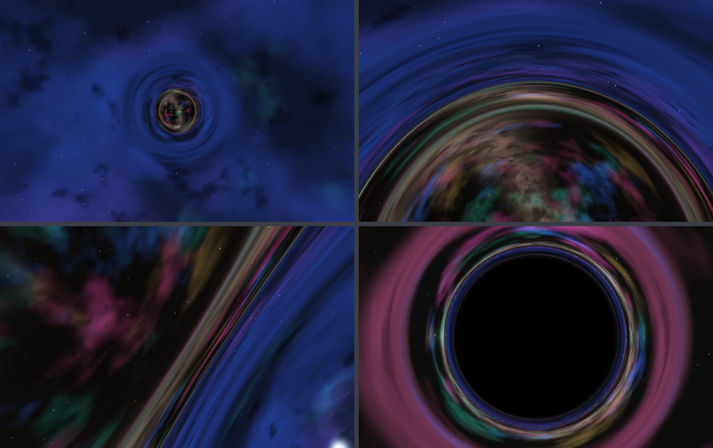

# Spacetime Edge

## Black Hole

Fly to a black hole, cut the engine, and fall in. Every pixel is a light ray traced through curved spacetime in real time.

## Wormhole

Fly through a wormhole into another universe, then turn back for home. Every pixel is a light ray traced through the throat in real time.

